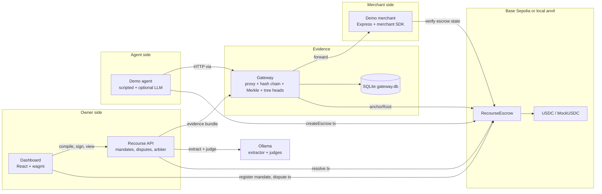
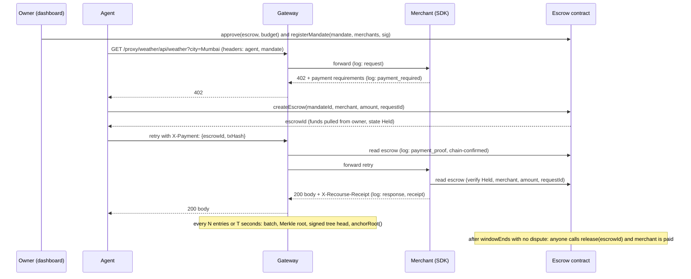
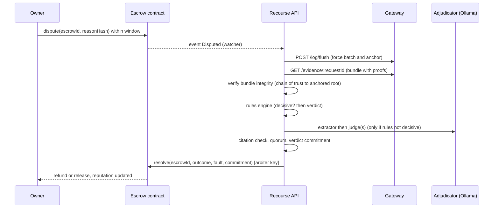

# ARCHITECTURE

System design, **folder structure**, dataflow, database schemas and ports for Recourse. Specs for formats live in `03-crypto-and-merkle-spec.md`; interfaces in `04-api-spec.md`.

## 1. System overview



## 2. Components

| Component | Path | Responsibility | Holds key |
|---|---|---|---|
| **Escrow contract** | `contracts/` | Mandate registry, enforcement, escrow, dispute, resolve, reputation counters, root anchors | n/a |
| **Gateway** (data plane) | `apps/gateway` | Proxy agent traffic to merchants, build tamper-evident log, batch Merkle roots, sign tree heads, anchor roots, serve evidence bundles | `GATEWAY_PRIVATE_KEY` |
| **API** (control plane) | `apps/api` | Mandate compile and storage, dispute watcher, adjudication orchestration, arbiter resolve tx, reputation and benchmark endpoints | `ARBITER_PRIVATE_KEY` |
| **Demo merchant** | `apps/demo-merchant` | Weather API with 402 flow; switchable failure modes | `MERCHANT_PRIVATE_KEY` |
| **Demo agent** | `apps/demo-agent` | Scripted scenarios; pays via escrow; calls through gateway | `AGENT_PRIVATE_KEY` |
| **Dashboard** | `apps/dashboard` | Mandate UI, run view, timeline, dispute and verdict view, verify page (browser-side), benchmark, reputation | owner wallet (or demo key) |
| **Benchmark** | `bench/` | Case generator, runner, metrics, report | n/a |
| **Shared libs** | `packages/*` | Types, hashing, merkle, chain client, SDK, rules, LLM, adjudicator, mandate compiler | n/a |

### Trust boundaries and key custody

- Four separate keys (gateway, arbiter, merchant, agent) plus an owner key. Never share a key between roles.
- The **agent cannot write** gateway log entries except through the proxy, and cannot edit or delete any entry. Agent-supplied "decision records" are logged as agent-claimed.
- The **arbiter** is the only address allowed to call `resolve`. The **gateway** address is the only one allowed to call `anchorRoot`. Both are set by the contract owner.
- The agent holds no funds. The owner pre-approves the escrow contract; the agent only triggers `createEscrow`, which the contract checks against the mandate.
- The agent still needs testnet ETH for gas (paymasters are roadmap).

## 3. Folder structure

Files marked (to create) do not exist yet. Numbering skips `02` on purpose: dataflow lives in this document.

```
recourse/
├── CLAUDE.md                          # Claude Code entry point
├── GUIDE.md                           # team collaboration, module ownership, workflow (give to every agent)
├── PRD.md                             # requirements and scope
├── README.md                          # (to create) one-page intro and quickstart
├── package.json                       # root scripts (pnpm)
├── pnpm-workspace.yaml
├── tsconfig.base.json
├── .env.example                       # all env vars, no secrets
├── .gitignore                         # includes .env, data/, bench/results/, node_modules, contracts/out, contracts/cache
├── .github/workflows/ci.yml           # forge test + pnpm typecheck + pnpm test (runs on PRs into dev and main)
├── .github/pull_request_template.md   # PR template (GUIDE.md section 8.1)
├── .github/CODEOWNERS                 # module owners (GUIDE.md section 2.1)
│
├── docs/
│   ├── 01-problem-and-novelty.md
│   ├── 03-crypto-and-merkle-spec.md
│   ├── 04-api-spec.md
│   ├── 05-demo-golden-path.md
│   ├── 06-frontend-agent-plan.md
│   ├── 07-build-plan.md
│   ├── 08-adjudicator-and-benchmark.md
│   ├── 09-security-and-threat-model.md
│   ├── 10-testing-and-quality.md
│   ├── TASKS.md                       # task board per lane (replaces GitHub issues)
│   ├── ARCHITECTURE.md
│   ├── DECISIONS.md
│   └── DEVELOPMENT.md
│
├── config/
│   ├── models.json                    # extractor + judge model names, temperature, seed
│   ├── alias-table.json               # entity aliases for rules (e.g. Bombay -> Mumbai)
│   └── demo.json                      # demo amounts, window, scenario list
│
├── deployments/
│   └── <chainId>.json                 # {escrow, token, gateway, arbiter, deployedAt} written by deploy script
│
├── contracts/                         # Foundry project
│   ├── foundry.toml
│   ├── remappings.txt
│   ├── src/
│   │   ├── RecourseEscrow.sol
│   │   ├── interfaces/IRecourseEscrow.sol
│   │   └── mocks/MockUSDC.sol
│   ├── test/
│   │   ├── RecourseEscrow.t.sol           # unit tests
│   │   ├── RecourseEscrow.Fuzz.t.sol      # fuzz tests
│   │   └── RecourseEscrow.Invariant.t.sol # invariants (no value created or lost, spent <= budget)
│   └── script/
│       ├── Deploy.s.sol
│       └── Seed.s.sol                     # fund owner with MockUSDC, set roles on local chain
│
├── packages/
│   ├── shared/                        # @recourse/shared (no internal deps)
│   │   ├── src/
│   │   │   ├── types.ts               # TS types inferred from zod
│   │   │   ├── schemas/               # zod, split by file for ownership (D-024): mandate.ts, evidence.ts, api.ts (P1); verdict.ts, rules.ts, facts.ts (P2)
│   │   │   ├── hash.ts                # keccak256, canonical JSON (RFC 8785), hex helpers
│   │   │   ├── eip712.ts              # domains, typed data, sign and recover helpers
│   │   │   ├── merkle.ts              # StandardMerkleTree wrappers, proofs
│   │   │   ├── commit.ts              # salted field commitments and disclosure proofs
│   │   │   ├── bundle.ts              # evidence bundle verification (used by arbiter and browser)
│   │   │   ├── errors.ts              # error codes and API error shape
│   │   │   └── config.ts              # env parsing with zod
│   │   └── test/ (incl. vectors.json test vectors)
│   ├── chain/                         # @recourse/chain: viem clients, ABI, escrow wrapper, event decoding
│   ├── merchant-sdk/                  # @recourse/merchant-sdk: Express middleware, 402 flow, receipts
│   ├── rules-engine/                  # @recourse/rules-engine: pure deterministic checks, alias table
│   ├── llm/                           # @recourse/llm: Ollama client, structured output, zod parse, retries
│   ├── mandate/                       # @recourse/mandate: compile (LLM to JSON), validate, render plain English, typed data
│   └── adjudicator/                   # @recourse/adjudicator: pipeline, extractor, judges, citations, quorum, commitment
│       ├── src/
│       └── prompts/                   # versioned prompt files (hashed into the verdict commitment)
│           ├── extractor.v1.md
│           ├── judge.v1.md
│           └── mandate-compiler.v1.md
│
├── apps/
│   ├── gateway/                       # data plane, port 4000
│   │   └── src/{index.ts, server.ts, proxy.ts, config.ts, store.ts, log/*, evidence/*, routes/*}
│   ├── api/                           # control plane, port 4100
│   │   └── src/{index.ts, server.ts, routes/*, services/{disputeWatcher.ts, arbiter.ts, evidenceClient.ts}, db/*}
│   ├── demo-merchant/                 # port 4200
│   │   └── src/{index.ts, modes/*, admin.ts}
│   ├── demo-agent/                    # port 4300
│   │   └── src/{index.ts, agent.ts, payer.ts, scenarios/*, cli.ts}
│   └── dashboard/                     # Vite dev server, port 5173
│       └── src/{main.tsx, App.tsx, pages/*, components/*, lib/{api.ts, wagmi.ts, verify.ts}}
│
├── bench/                             # @recourse/bench
│   ├── generator/{templates.ts, generate.ts}
│   ├── runner/{run.ts, configs.ts, metrics.ts}
│   ├── report/report.ts
│   ├── cases/                         # generated cases (committed sample, full set regenerable by seed)
│   └── results/                       # gitignored run outputs
│
├── scripts/
│   ├── dev-chain.sh                   # start anvil
│   ├── sync-deployment.ts             # copy addresses into .env and deployments/
│   ├── seed.ts                        # fund accounts, set roles, register demo merchant
│   ├── reset-demo.ts                  # wipe data/, redeploy or reseed, restart state
│   ├── gen-test-vectors.ts            # writes packages/shared/test/vectors.json
│   └── demo.ts                        # run the full golden path headlessly
│
└── data/                              # gitignored: gateway.db, api.db, blobs
```

### Package dependency rules

```
shared  <-  chain  <-  merchant-sdk
shared  <-  rules-engine
shared  <-  llm
shared, rules-engine, llm  <-  adjudicator
shared, llm  <-  mandate
apps/*  may import any package; apps never import other apps
bench   imports adjudicator, rules-engine, shared
```
No cycles. `packages/shared` imports no other workspace package.

## 4. Dataflow

### 4.1 Payment (happy path)



### 4.2 Dispute and verdict



### 4.3 Tamper test (browser)

The dashboard verify page loads an evidence bundle or a full batch, recomputes every hash with the same code as `packages/shared`, checks Merkle proofs against the signed tree head, and (optionally) reads `anchoredAt(root)` from the chain. The user edits one byte in the displayed entry; a check turns red. No server call is needed for verification.

## 5. Data stores

> The SQL below is the **logical design**. The source of truth for tables is the Drizzle schema (`apps/gateway/src/db/schema.ts`, `apps/api/src/db/schema.ts`) and its generated migrations; see `GUIDE.md` section 6. Each app owns its own database; apps never read each other's database.

### 5.1 Gateway SQLite (`data/gateway.db`)

```sql
CREATE TABLE entries (
  seq INTEGER PRIMARY KEY,           -- global, gapless, starts at 1
  ts INTEGER NOT NULL,               -- unix seconds, gateway clock
  type TEXT NOT NULL,                -- request|payment_required|payment_proof|response|receipt|decision
  request_id TEXT NOT NULL,          -- 0x bytes32
  mandate_id TEXT,                   -- 0x bytes32 or NULL
  agent_id TEXT,                     -- 0x address or NULL
  payload_commitment TEXT NOT NULL,  -- 0x bytes32 (root of field commitments)
  prev_hash TEXT NOT NULL,           -- 0x bytes32
  entry_hash TEXT NOT NULL,          -- 0x bytes32
  batch_index INTEGER                -- NULL until batched
);
CREATE INDEX entries_request ON entries(request_id);

CREATE TABLE fields (                -- private: values and salts for selective disclosure
  seq INTEGER NOT NULL,
  name TEXT NOT NULL,
  value_json TEXT NOT NULL,          -- canonical JSON of the value
  salt TEXT NOT NULL,                -- 0x bytes32
  PRIMARY KEY (seq, name)
);

CREATE TABLE blobs (                 -- raw response bodies, keyed by keccak256(body)
  body_hash TEXT PRIMARY KEY,
  content BLOB NOT NULL
);

CREATE TABLE batches (
  batch_index INTEGER PRIMARY KEY,
  first_seq INTEGER NOT NULL,
  last_seq INTEGER NOT NULL,
  root TEXT NOT NULL,
  size INTEGER NOT NULL,             -- cumulative entries count at this head
  ts INTEGER NOT NULL,
  tree_dump TEXT NOT NULL,           -- StandardMerkleTree.dump() JSON
  signature TEXT NOT NULL,           -- EIP-712 TreeHead signature
  anchor_tx TEXT,                    -- NULL until anchored
  anchor_block INTEGER
);
```

### 5.2 API SQLite (`data/api.db`)

```sql
CREATE TABLE mandates (
  mandate_id TEXT PRIMARY KEY,       -- EIP-712 digest
  owner TEXT NOT NULL, agent TEXT NOT NULL,
  mandate_json TEXT NOT NULL,        -- on-chain struct fields
  terms_json TEXT NOT NULL,          -- off-chain terms (canonical JSON)
  terms_hash TEXT NOT NULL,
  merchants_json TEXT NOT NULL,
  signature TEXT NOT NULL,
  summary TEXT NOT NULL,             -- plain-English render shown to owner
  created_at INTEGER NOT NULL
);

CREATE TABLE disputes (
  dispute_id TEXT PRIMARY KEY,       -- uuid
  escrow_id TEXT NOT NULL UNIQUE,
  mandate_id TEXT NOT NULL,
  request_id TEXT NOT NULL,
  reason_text TEXT,                  -- untrusted; only the extractor sees it
  reason_hash TEXT NOT NULL,         -- matches on-chain reasonHash
  status TEXT NOT NULL,              -- opened|evidence_ready|adjudicating|resolved|needs_human_review|failed
  opened_tx TEXT, resolved_tx TEXT,
  created_at INTEGER NOT NULL, updated_at INTEGER NOT NULL
);

CREATE TABLE verdicts (
  dispute_id TEXT PRIMARY KEY,
  verdict_json TEXT NOT NULL,        -- full Verdict (docs/08)
  commitment TEXT NOT NULL,
  created_at INTEGER NOT NULL
);

CREATE TABLE bench_runs (run_id TEXT PRIMARY KEY, config_json TEXT NOT NULL, results_json TEXT NOT NULL, created_at INTEGER NOT NULL);
```

## 6. Ports and processes

| Process | Port | Command (from root) |
|---|---|---|
| anvil (local chain) | 8545 | `pnpm chain:up` |
| gateway | 4000 | `pnpm --filter @recourse/gateway dev` |
| api | 4100 | `pnpm --filter @recourse/api dev` |
| demo-merchant | 4200 | `pnpm --filter @recourse/demo-merchant dev` |
| demo-agent | 4300 | `pnpm --filter @recourse/demo-agent dev` |
| dashboard | 5173 | `pnpm --filter @recourse/dashboard dev` |
| Ollama | 11434 | `ollama serve` |

`pnpm dev` starts gateway, api, demo-merchant, demo-agent and dashboard together.

## 7. Technology stack

| Layer | Choice |
|---|---|
| Contracts | Solidity, Foundry (forge, anvil), OpenZeppelin (EIP712, ECDSA, SignatureChecker, Pausable, ReentrancyGuard, SafeERC20) |
| Chain | Base Sepolia (chain id 84532) with testnet USDC; local anvil (chain id 31337) as fallback |
| Chain client | viem (backend and frontend), wagmi in the dashboard |
| Backend | Node current LTS, TypeScript strict, Fastify (gateway, api), Express (demo merchant and SDK middleware), pino logging, zod |
| Storage | SQLite via better-sqlite3, accessed through Drizzle ORM; schema in `src/db/schema.ts` per app, migrations generated by drizzle-kit into `drizzle/` (D-022) |
| Hashing and Merkle | keccak256, RFC 8785 canonical JSON (`json-canonicalize`), `@openzeppelin/merkle-tree` |
| AI | Ollama local models: one extractor, up to three judges; structured output via JSON schema, validated with zod |
| Frontend | React, Vite, TypeScript, Tailwind, TanStack Query, Recharts |
| Testing | forge test (unit, fuzz, invariant), Vitest, supertest for HTTP |
| Tooling | pnpm workspaces, ESLint, Prettier, solhint, GitHub Actions |

## 8. Non-functional design notes

- **Reproducibility:** one command starts everything; seeded demo data; `config/models.json` pins models and settings.
- **Cost control:** batch anchoring (default 16 entries or 30 seconds), evidence blobs off-chain, only roots on-chain.
- **Scaling path (roadmap):** per-agent log chains with stateless signers rolled into a global tree; tiered escrow (prepaid sessions with batched SLA credits for micro payments); tiered arbitration (rules, single AI, panel, human appeal). See `PRD.md` section 14.
- **Observability:** pino JSON logs with `request_id` and `dispute_id` on every line.
